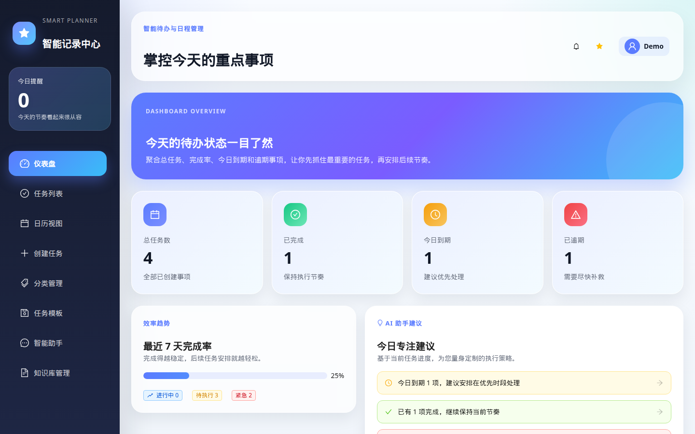
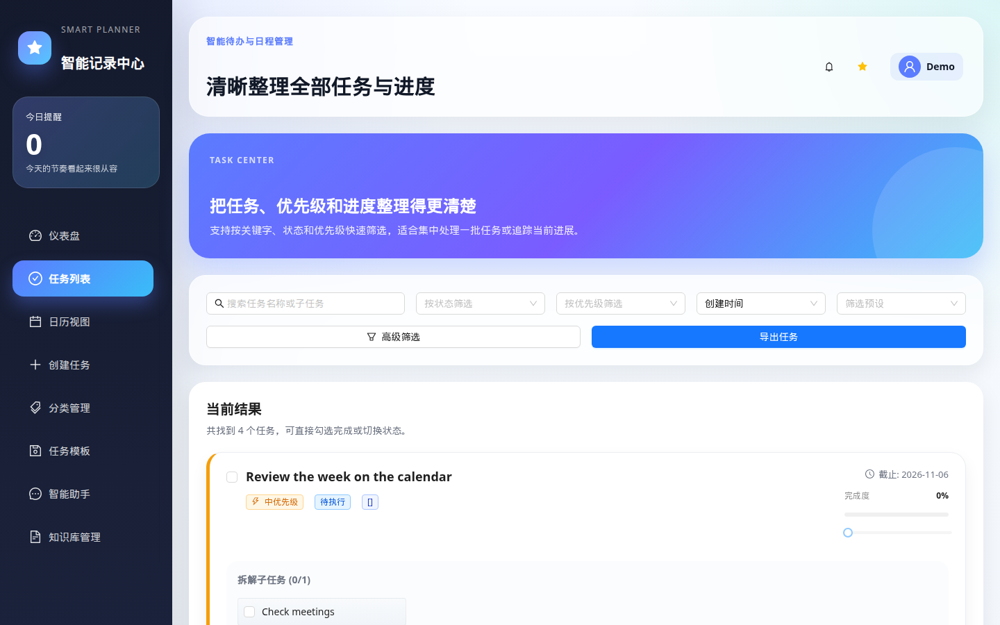
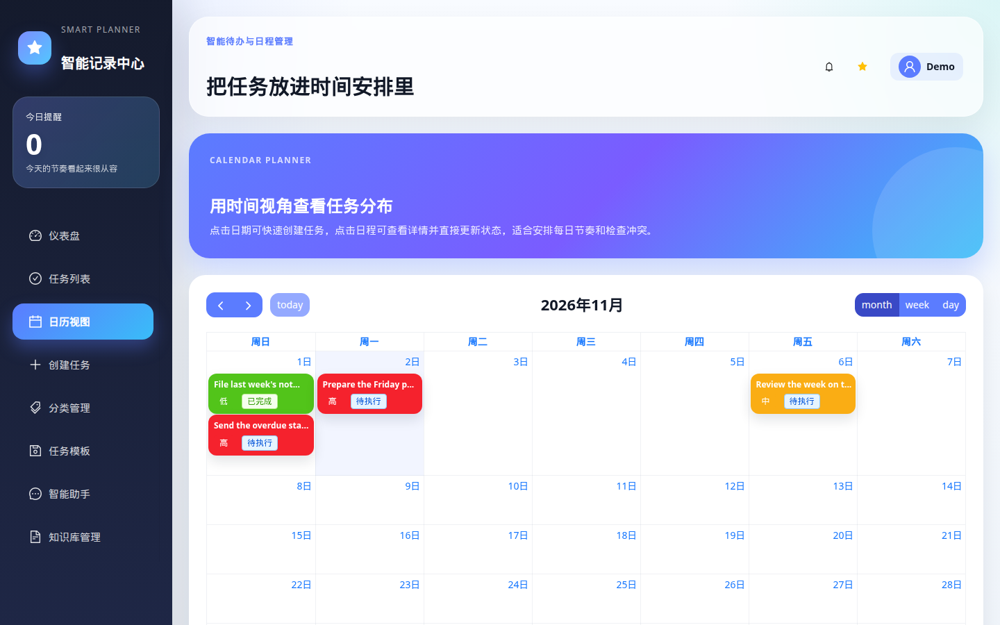

# AIPlanner

[English](#english) | [中文](#中文)

Natural-language tasks, a calendar, reminders, and a local knowledge-base assistant. FastAPI and LangGraph on the server, React on the client.

This repository is the application source. It does not include a hosted deployment, usage numbers, or customer data.

## English

### Features

- Accounts with bcrypt password hashes and JWT sessions.
- Tasks with priority, category, tags, sub-tasks, progress, and status. Tasks can be created manually, or from a natural-language note through a LangGraph workflow when an LLM API key is configured.
- Dashboard counts, a filterable task list, and a FullCalendar month/week/day view.
- Reminders through the in-app panel, the browser Notification API, and optional SMTP email. Deadline checks are scheduled with APScheduler.
- A chat assistant, plus a SQLite knowledge base. Retrieval is local keyword and term-frequency similarity, not a separate vector database.
- JSON and CSV export, and file backup/restore.
- An alternate Streamlit client in `frontend/app.py`. The React app under `frontend/react-ts` is the interface shown below.

### Tech stack

| Area | Choices |
| --- | --- |
| API | Python 3.9+, FastAPI, Uvicorn |
| Agent | LangGraph, an OpenAI-compatible chat API |
| Data | SQLite, through the standard library |
| Auth | PyJWT, bcrypt |
| Jobs and mail | APScheduler, SMTP |
| Web UI | React 18, TypeScript, Vite, Ant Design 5, Zustand, FullCalendar |
| Alternate UI | Streamlit |

### Architecture

The browser talks to a FastAPI process. Task CRUD, auth, categories, templates, backup, and the knowledge base read and write `todo_agent.db` in the working directory. Natural-language task creation and chat call the configured LLM. A background scheduler checks due dates and can send mail when SMTP settings are present.

```
React (Vite, port 3000)
        |  /api
        v
FastAPI (Uvicorn, port 8000)
        |-- auth, tasks, calendar data, backup
        |-- LangGraph workflow and chat
        |-- reminder scheduler and optional SMTP
        v
SQLite (todo_agent.db)          OpenAI-compatible LLM API
```

```
AIPlanner/
├── backend/
│   ├── main.py            # FastAPI routes
│   ├── agent/             # LangGraph workflow, tools, model config
│   ├── db/                # SQLite access
│   └── service/           # auth, reminders, email, backup, knowledge search
├── frontend/
│   ├── react-ts/          # React UI
│   └── app.py             # Streamlit client for the same API
├── tests/                 # pytest smoke tests
├── docs/images/           # screenshots from a local run
├── requirements.txt
├── requirements-dev.txt
└── .env.example
```

Longer Chinese notes live in `项目架构文档.md` and `BACKEND_DATABASE_MODULE.md`.

### Screenshots

These three images are from a local development run on 2 November 2026. A local user named Demo and four sample tasks were created only for the capture. The counts on screen are those sample tasks. This is not a production deployment.

The interface text is Chinese.







### Quickstart

Requirements: Python 3.9+, Node.js 18+, npm 9+.

```bash
git clone https://github.com/hjlangcore/AIPlanner.git
cd AIPlanner
python3 -m venv venv
source venv/bin/activate   # Windows: venv\Scripts\activate
pip install -r requirements.txt
cp .env.example .env
```

Edit `.env` and set `LLM_API_KEY` and `JWT_SECRET_KEY`. The API process exits on import if either one is missing. A placeholder key is enough to boot the server and use manual tasks. Natural-language create and chat need a key that the provider accepts.

```bash
uvicorn backend.main:app --host 127.0.0.1 --port 8000 --reload
```

In a second terminal:

```bash
cd frontend/react-ts
npm install
npm run dev
```

- App: http://localhost:3000
- API: http://localhost:8000
- Interactive API docs: http://localhost:8000/docs

The Vite dev server proxies `/api` to port 8000. For a static frontend build, run `npm run build` in `frontend/react-ts` and serve `dist/` yourself. There is no deployment config in this repo.

Optional Streamlit client, with the API already running:

```bash
streamlit run frontend/app.py
```

### Configuration

Copy `.env.example` to `.env`. Do not commit `.env`.

| Variable | Required to boot | What the code does with it |
| --- | --- | --- |
| `LLM_API_KEY` | Yes | Key for the OpenAI-compatible client in `backend/agent/llm_config.py`. |
| `JWT_SECRET_KEY` | Yes | HMAC secret for access tokens. `backend/service/auth_service.py` has no default. |
| `LLM_BASE_URL` | No | API base URL. `llm_config.py` leaves it unset unless you set it. `agent_config.py` defaults the same variable to `https://dashscope.aliyuncs.com/compatible-mode/v1`. |
| `LLM_MODEL` | No | Chat model name. `llm_config.py` defaults to `deepseek-chat`. `agent_config.py` defaults to `qwen-turbo` when the variable is unset. Set it if you want both paths to match. |
| `LLM2_MODEL` | No | Agent decision model in `llm_config.py`. Default `qwen-max`. |
| `DASHSCOPE_API_KEY` | No | Legacy alias used only when `LLM_API_KEY` is empty. |
| `ALLOWED_ORIGINS` | No | Comma-separated CORS origins. Default `http://localhost:3000,http://localhost:8080`. |
| `SMTP_SERVER` | No | SMTP host for email reminders. Empty skips mail. |
| `SMTP_PORT` | No | Default `587`. |
| `SMTP_USER` | No | SMTP username. |
| `SMTP_PASS` | No | SMTP password. |
| `SENDER_EMAIL` | No | From address. |
| `RECEIVER_EMAIL` | No | Default recipient used by the mail service. |

The listen port is the `--port` argument to Uvicorn, not an environment variable. SQLite is created as `todo_agent.db` in the process working directory.

### Tests

```bash
pip install -r requirements.txt -r requirements-dev.txt
pytest
ruff check backend tests
```

`tests/test_smoke.py` covers task create/read/update/delete, password hashing, login, and manual task creation through the API. It does not call an LLM. GitHub Actions (`.github/workflows/ci.yml`) runs that pytest file and a small Ruff check on Python 3.12.

`npm run lint` has no ESLint config in the repo, and `tsc --noEmit` currently reports existing TypeScript errors. Those commands are not part of CI.

### License

[MIT License](LICENSE). Copyright (c) 2026 hjlangcore.

### Contact

- GitHub: [@hjlangcore](https://github.com/hjlangcore)
- Issues: [hjlangcore/AIPlanner](https://github.com/hjlangcore/AIPlanner/issues)

---

## 中文

用自然语言记一条待办，并配有日历、提醒和本地知识库助手。服务端是 FastAPI 与 LangGraph，界面是 React。

本仓库是应用源码，不包含线上部署、使用量数据或客户数据。

### 功能

- 使用 bcrypt 保存密码，使用 JWT 维持登录。
- 任务包含优先级、分类、标签、子任务、进度和状态。可以手工创建，也可以在配置了大模型密钥后，通过 LangGraph 把自然语言记成任务。
- 仪表盘统计、可筛选的任务列表，以及 FullCalendar 的月/周/日视图。
- 提醒走应用内面板、浏览器 Notification API，以及可选的 SMTP 邮件。到期检查由 APScheduler 触发。
- 对话助手，以及保存在 SQLite 里的知识库。检索是本地关键词和词频相似度，不是独立的向量数据库。
- JSON / CSV 导出，以及文件备份与恢复。
- `frontend/app.py` 是一个 Streamlit 客户端。下面的截图来自 `frontend/react-ts`。

### 技术栈

| 部分 | 选型 |
| --- | --- |
| API | Python 3.9+、FastAPI、Uvicorn |
| Agent | LangGraph，兼容 OpenAI 的对话接口 |
| 数据 | SQLite（标准库） |
| 认证 | PyJWT、bcrypt |
| 定时与邮件 | APScheduler、SMTP |
| Web 界面 | React 18、TypeScript、Vite、Ant Design 5、Zustand、FullCalendar |
| 备用界面 | Streamlit |

### 架构

浏览器请求 FastAPI。任务、登录、分类、模板、备份和知识库都读写工作目录下的 `todo_agent.db`。自然语言创建任务和对话会调用已配置的大模型。后台调度器检查截止日期，并在配置了 SMTP 时发邮件。

```
React（Vite，端口 3000）
        |  /api
        v
FastAPI（Uvicorn，端口 8000）
        |-- 认证、任务、日历数据、备份
        |-- LangGraph 工作流与对话
        |-- 提醒调度与可选 SMTP
        v
SQLite（todo_agent.db）        兼容 OpenAI 的大模型接口
```

目录说明见英文部分的结构树。更长的中文说明在 `项目架构文档.md` 和 `BACKEND_DATABASE_MODULE.md`。

### 截图

下面三张图来自 2026 年 11 月 2 日的本地开发运行。为了截图，只在本地创建了名为 Demo 的用户和 4 条示例任务。画面上的数字就是这些示例任务，不是线上环境。

界面文案是中文。


### 快速开始

需要 Python 3.9+、Node.js 18+、npm 9+。

```bash
git clone https://github.com/hjlangcore/AIPlanner.git
cd AIPlanner
python3 -m venv venv
source venv/bin/activate   # Windows: venv\Scripts\activate
pip install -r requirements.txt
cp .env.example .env
```

编辑 `.env`，填入 `LLM_API_KEY` 和 `JWT_SECRET_KEY`。这两个值缺失时，API 会在导入阶段退出。占位密钥可以启动服务并使用手工任务。自然语言创建和对话需要供应商接受的密钥。

```bash
uvicorn backend.main:app --host 127.0.0.1 --port 8000 --reload
```

另一个终端：

```bash
cd frontend/react-ts
npm install
npm run dev
```

- 应用：http://localhost:3000
- API：http://localhost:8000
- 交互式 API 文档：http://localhost:8000/docs

Vite 开发服务器把 `/api` 代理到 8000 端口。静态构建在 `frontend/react-ts` 中执行 `npm run build`，然后自行托管 `dist/`。仓库里没有部署配置。

API 已启动时，可以另外运行 Streamlit 客户端：

```bash
streamlit run frontend/app.py
```

### 配置

把 `.env.example` 复制为 `.env`。不要提交 `.env`。

| 变量 | 启动是否必需 | 代码中的用途 |
| --- | --- | --- |
| `LLM_API_KEY` | 是 | `backend/agent/llm_config.py` 里 OpenAI 兼容客户端的密钥。 |
| `JWT_SECRET_KEY` | 是 | 访问令牌的 HMAC 密钥。`backend/service/auth_service.py` 没有默认值。 |
| `LLM_BASE_URL` | 否 | 接口地址。`llm_config.py` 在未设置时保持为空。`agent_config.py` 在未设置时默认为 `https://dashscope.aliyuncs.com/compatible-mode/v1`。 |
| `LLM_MODEL` | 否 | 对话模型。`llm_config.py` 默认为 `deepseek-chat`。变量未设置时，`agent_config.py` 默认为 `qwen-turbo`。需要两边一致时请显式设置。 |
| `LLM2_MODEL` | 否 | `llm_config.py` 中的 Agent 决策模型，默认 `qwen-max`。 |
| `DASHSCOPE_API_KEY` | 否 | 仅在 `LLM_API_KEY` 为空时使用的旧键名。 |
| `ALLOWED_ORIGINS` | 否 | 逗号分隔的 CORS 来源，默认 `http://localhost:3000,http://localhost:8080`。 |
| `SMTP_SERVER` | 否 | 邮件提醒的 SMTP 主机。留空则不发邮件。 |
| `SMTP_PORT` | 否 | 默认 `587`。 |
| `SMTP_USER` | 否 | SMTP 用户名。 |
| `SMTP_PASS` | 否 | SMTP 密码。 |
| `SENDER_EMAIL` | 否 | 发件地址。 |
| `RECEIVER_EMAIL` | 否 | 邮件服务使用的默认收件人。 |

监听端口是 Uvicorn 的 `--port` 参数，不是环境变量。SQLite 文件是进程工作目录下的 `todo_agent.db`。

### 测试

```bash
pip install -r requirements.txt -r requirements-dev.txt
pytest
ruff check backend tests
```

`tests/test_smoke.py` 覆盖任务的创建、读取、更新、删除，以及密码哈希、登录和手工创建任务的 API。测试不会调用大模型。GitHub Actions（`.github/workflows/ci.yml`）在 Python 3.12 上运行这些 pytest 和一组较小的 Ruff 检查。

仓库里没有 ESLint 配置，`npm run lint` 目前无法按脚本运行。`tsc --noEmit` 会报告已有的 TypeScript 错误。这两项不在 CI 里。

### 许可证

[MIT License](LICENSE)。Copyright (c) 2026 hjlangcore。

### 联系

- GitHub: [@hjlangcore](https://github.com/hjlangcore)
- Issues: [hjlangcore/AIPlanner](https://github.com/hjlangcore/AIPlanner/issues)
